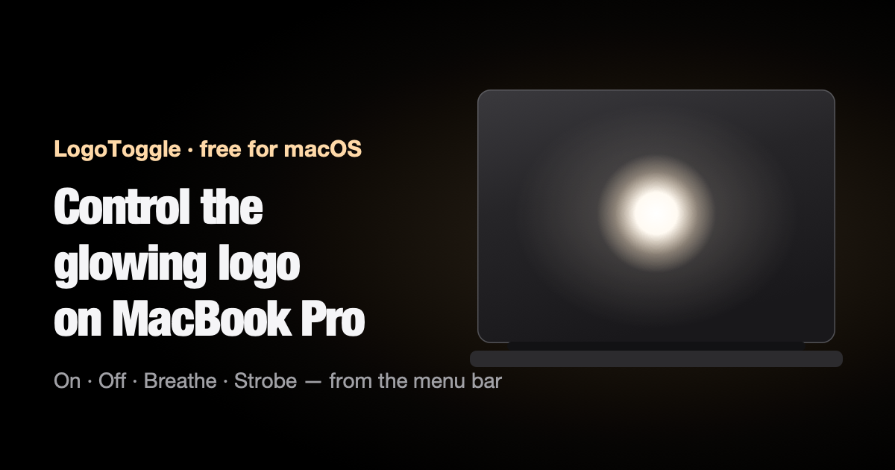

<p align="center">
  <a href="https://jamesfergus2000.github.io/LogoToggle/">
    
  </a>
</p>

<h1 align="center">LogoToggle</h1>

<p align="center">
  A free menu bar app for the glowing Apple logo on the MacBook Pro with PROLED XDR Display.<br>
  Turn it off, turn it on, make it breathe or make it strobe. Or just clap twice.
</p>

<p align="center">
  <a href="https://jamesfergus2000.github.io/LogoToggle/"><strong>Website</strong></a> ·
  <a href="#install"><strong>Install</strong></a> ·
  <a href="#compatibility"><strong>Compatibility</strong></a> ·
  <a href="https://jamesfergus2000.github.io/LogoToggle/turn-off-glowing-apple-logo-macbook-pro/"><strong>Turn it off without an app</strong></a>
</p>

<p align="center">
  <a href="https://github.com/JamesFergus2000/LogoToggle/releases/latest"></a>
  
  
  <a href="LICENSE"></a>
</p>

## Install

Open Terminal, paste this and press Return:

```sh
curl -fsSL https://jamesfergus2000.github.io/LogoToggle/install.sh | sh
```

LogoToggle downloads, installs into Applications and appears in your menu bar, with no Gatekeeper
prompt. You can [read the install script](docs/install.sh) first; it's under 50 lines.

Other ways to install are [further down](#other-ways-to-install).

## What it does

| Mode | What happens |
| --- | --- |
| **Off** | The logo goes dark and stays off, even after you restart. No password needed. |
| **On** | The glow comes back. It still follows your screen brightness and the light in the room, as macOS intended. |
| **Breathe** | A smooth fade in and out, using the light's own hardware fades. Slow, medium or fast. |
| **Strobe** | Hard on, hard off, up to about four times a second. Slow, medium or fast. |
| **Clap** | Optional. Clap twice and the logo switches on or off. |

It's one Swift file with no dependencies, and it lives only in the menu bar (no Dock icon).

> [!WARNING]
> **Photosensitivity:** strobe mode flashes up to about 4 times a second. Don't use it around people
> who may be affected by flashing lights.

## Compatibility

LogoToggle is made for the **MacBook Pro with PROLED XDR Display**, the only Mac with an illuminated
Apple logo.

| Mac | Chip | Glowing logo | LogoToggle |
| --- | --- | :---: | --- |
| 14-inch MacBook Pro with PROLED XDR Display | M5 Pro, M5 Max | ✅ | Works |
| 16-inch MacBook Pro with PROLED XDR Display | M5 Pro, M5 Max | ✅ | Works |
| MacBook Pro with Liquid Retina XDR display | M6, M5 Pro, M5 Max and earlier | ❌ | Nothing to control |
| MacBook Air | Any | ❌ | Nothing to control |

It also needs **macOS 27 or later**.

Not sure which Mac you have? If the logo on the lid glows when the Mac is awake, you're set. More
detail: [Which MacBook Pro has the glowing Apple logo?](https://jamesfergus2000.github.io/LogoToggle/which-macbook-pro-has-glowing-apple-logo/)

## Using it

Click the LogoToggle icon in the menu bar:

- **Turn logo off / Turn logo on** switches the light.
- **Breathe** and **Strobe** each open a submenu with Slow, Medium and Fast.
- **Clap twice to toggle** turns clap control on or off. macOS asks for microphone access the first
  time. Then clap twice in quick succession to switch the logo. If breathe or strobe is
  running, a double clap stops it and leaves the logo off.
- **Quit** closes the app.

To start it automatically, add it under **System Settings → General → Login Items**.

## Other ways to install

### Download

1. Download [`LogoToggle.zip`](https://github.com/JamesFergus2000/LogoToggle/releases/latest/download/LogoToggle.zip) and unzip it.
2. Move `LogoToggle.app` to Applications and open it.
3. macOS blocks it the first time, because the app isn't notarized by Apple. Go to
   **System Settings → Privacy & Security**, scroll down and click **Open Anyway**. Or run:
   ```sh
   xattr -dr com.apple.quarantine /Applications/LogoToggle.app
   ```

### Build from source

You'll need the Xcode Command Line Tools (`xcode-select --install`).

```sh
git clone https://github.com/JamesFergus2000/LogoToggle.git
cd LogoToggle
./build.sh --install     # builds and copies to ~/Applications
open ~/Applications/LogoToggle.app
```

Apps you build yourself aren't quarantined, so there's no Gatekeeper prompt.

## Questions

**Can I change how bright the logo is?**
No. macOS has no brightness setting for the logo. It dims and brightens automatically with your
screen brightness and the light in the room.

**Is clap control recording me?**
No. It's off until you tick it in the menu. While it's on, LogoToggle only measures how loud the
microphone is, in memory, to spot two sharp claps. Nothing is saved or sent anywhere, and it stops
listening when the display sleeps. macOS shows its orange microphone dot while it's listening.

**Could a macOS update break it?**
Possibly. LogoToggle uses an undocumented part of macOS. If that changes, on/off falls back to
Apple's documented command and the effects stop until there's an update.

**Why isn't it on the Mac App Store?**
App Store apps can't use undocumented system interfaces, which LogoToggle relies on.

**Can I turn the logo off without installing anything?**
Yes, with Apple's Terminal command. See the
[step-by-step guide](https://jamesfergus2000.github.io/LogoToggle/turn-off-glowing-apple-logo-macbook-pro/).

## How it works

LogoToggle talks to `corebrightnessd`, the system service that drives the logo LED, through
`BrightnessSystemClient` in the private `CoreBrightness` framework. That works without root.

| Key | Used for |
| --- | --- |
| `LEBacklightMode` | `0` off, `2` on: the on/off switch and strobe |
| `DisplayLogicalState` | `1` Blank / `2` Unblank fades the logo: used for breathe |
| `LEPWMFactorFadeDuration` | how long the next fade takes |

The keyboard backlight also follows `DisplayLogicalState`, so after each fade-out LogoToggle tells
the keyboards on their own to stay lit.

If the private API is missing, on/off falls back to the command from Apple's support article
"About the illuminated Apple logo on MacBook Pro with PROLED XDR Display", which needs an admin
password:

```sh
sudo defaults write com.apple.CoreBrightness LEBacklightMode -int 0   # off
sudo defaults delete com.apple.CoreBrightness LEBacklightMode         # on
```

## Credits

The `DisplayLogicalState` fade technique and the keyboard workaround come from the excellent
research in [**LogoLight**](https://github.com/Ark0N/LogoLight) by Ark0N
([docs/corebrightnessd.md](https://github.com/Ark0N/LogoLight/blob/main/docs/corebrightnessd.md)),
which is MIT-licensed. If you want brightness control, more effects, sound-reactive mode, Morse code
or Control Center integration, use LogoLight. LogoToggle is the minimal version.

The 3D model on the website is
[MacBook Pro 14-inch M5](https://sketchfab.com/3d-models/macbook-pro-14-inch-m5-652a992f4f244122ae251f9cbb81da1e)
by Apple User on Sketchfab (Free Standard licence), modified.

## Licence

MIT. See [LICENSE](LICENSE).

Not affiliated with or endorsed by Apple Inc. Apple, MacBook Pro and the Apple logo are trademarks
of Apple Inc.
